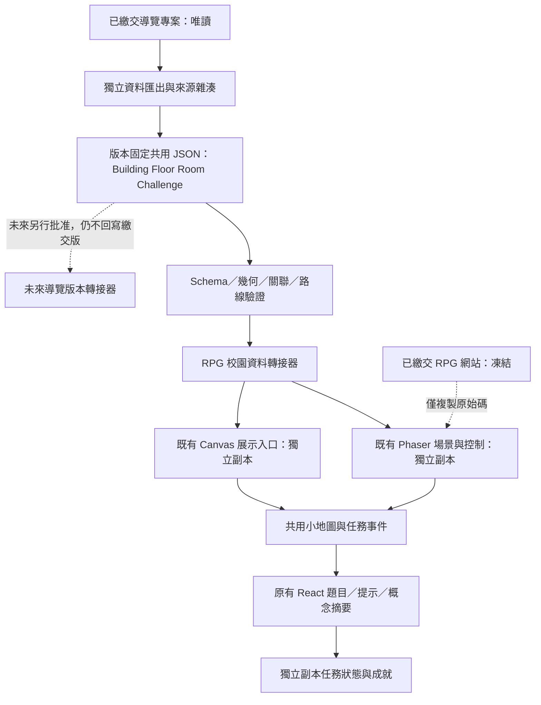

# 大溪國中未來科技校園 RPG 2.0：現況盤點與整合設計

日期：2026-10-13。本文件保存最初唯讀盤點與設計，並非最新發布狀態。使用者後續已授權逐階段實作與 GitHub 發布、保持既有 URL；最新邊界與執行進度以同目錄 EXECUTION.md 與 README.md 為準。下方「本輪不發布／凍結」描述僅屬當時盤點階段。

## 1．最終限制與本輪範圍

兩項競賽作品已繳交。本輪不修改 `daxi-campus-map`、`future-campus-rpg` 的程式、地圖、素材、設定或公開網站；不執行建置、封裝、Git 提交、推送或部署。分析檔案全部放在本資料夾，位於兩個專案之外。

後續若開發示範，應使用另外命名的獨立工作副本，例如 `future-campus-rpg-2-experiment`。此名稱只是建議，本輪沒有建立或修改遊戲副本。它應由現有 RPG 複製而來，保留架構；導覽資料只讀入版本固定的快照，不回寫導覽專案。兩個已繳交網站永遠不作為實驗部署目標。

盤點來源：

- 導覽：`F:\1151005---創意教學\daxi-campus-map`，盤點時本機 HEAD 為 `f990704`，工作目錄另有既存 QA 圖檔與文件變更，均未碰觸。
- RPG：`F:\1151005---創意教學\future-campus-rpg`，本資料夾沒有自己的 Git 儲存庫，不能把導覽的 commit 當成 RPG 來源版本。
- 導覽內 `public/proposal/rpg` 與 `submission-source/rpg-source.zip` 是另外的發布／封裝副本，不能假設與 RPG 原始碼即時同步。
- `daxi-80th-campus-rpg` 是另一套實作，本次不納入，也不覆寫。

`audit.cjs` 對兩專案的自有來源、設定、測試與資產做完整檔案掃描、文字／引用索引及雜湊紀錄：導覽 368 檔、RPG 134 檔。排除 node_modules、Git 內部、dist、vendor、既有 QA、備份及導覽內重複的 public/proposal。重點程式逐段檢查涵蓋入口、資料載入、幾何編譯、碰撞、導航、人物、NPC、對話、題目、進度及部署。未對第三方壓縮引擎逐行審查，也未將靜態分析說成全站操作驗收。

## 2．結論

可以重用導覽新版的建築、樓層、房間、走廊、門與樓梯關聯，但應透過資料匯出器與 RPG 轉接層使用。不能直接把 Three.js 畫面、舊版座標或現有 RPG 美術背景當成共同地理資料。

建議第一個示範為「校門 → 科技館一樓 → 南翼樓梯 → 二樓電腦教室二 → 任務導師 → 能源核心五題」。理由是科技館已有兩層、單組樓梯、十個房間，且 RPG 原本任務也以科技館為敘事入口。此選擇不表示真實數學老師任教於該教室；NPC 必須標示為遊戲任務配置。

最重要的資料風險是：導覽最新版仍明說尺寸與部分梯段為示意，92 個房間中有 21 個名稱待確認。共用資料必須保留來源與信心標籤，不能因為轉成 JSON 就宣稱實測正確。

## 3．兩個專案實際執行路徑

### 3.1 導覽

`src/main.tsx` 預設建立 iframe，載入 `public/campus-explorer/index.html`。主體是原生 JavaScript、DOM 與 Three.js WebGL，使用 classic scripts 共用全域作用域，並依 HTML 順序執行：

1. `campus-data.js` 定義 BUILDINGS_CONFIG 與初始房間。
2. `spatial-plan-data.js` 更正／替換房間、固定空間碼、樓層與空間配置，加入 spatialProfile、aliases。
3. `spatial-plan.js` 提供純幾何編譯器；`explorer.js` 建立場景、初始碰撞、ROOMS_DB 與 NAV_NODES。
4. `walk-world-math.js` 在存在 spatialProfile 時委派給 CampusSpatialPlan。
5. `spatial-world.js` 依最新模型重建樓板、牆、門、樓梯、碰撞及導航圖，取代初始 NAV_NODES。
6. `room-layout.js` 再套用該瀏覽器的年度教室名稱；其後 UI、師生與外觀模組引用執行中的模型。

因此「只讀 campus-data.js」仍會讀到被後續修正的舊房間或舊樓層；「只擷取 explorer.js 中的 NAV_NODES」也會取得初始化圖，而不是最終圖。

`?viewer=legacy` 才會載入 React 舊版；其 `src/data/campus-model.ts`、`campus-spaces.ts` 與 `campus-data.json` 是另一組簡化資料。舊版的 floor UI 還會回覆「室內導覽規劃中」，不代表預設新版沒有室內功能。

### 3.2 RPG

- `index.html → src/main.tsx → App → GameShell → Phaser`：TypeScript／React／Phaser 3，Canvas renderer、Arcade Physics，依 Boot → Preload → Campus／ResearchLab 與 UIScene 啟動。生產建置使用 `phaser-lite.cjs`。
- `presentation.html → src/presentation/main.ts`：原生 Canvas 2D、TypeScript 與 RAF，自行處理碰撞、鏡頭、輸入；開始任務時才動態載入 React `DemoQuest`。
- 兩入口共用 MapConfig、scaleMap、NPC 巡邏與 world-hud，但渲染、人物物理、門口切換與任務暫停仍各有實作。
- 公開報名版本是將建置後的 presentation.html 當作 index.html，延續虛構研究員設定；不能把本機 Phaser 的真人教師素材當成公開版已使用。

## 4．功能比較表

| 項目 | 導覽預設新版 | RPG 現況 | 整合判斷 |
|---|---|---|---|
| 技術 | 原生 JS＋Three.js WebGL；Vite 外殼 | TS＋React＋Phaser Canvas；另有輕量 Canvas | 保留 RPG，取資料與純演算法 |
| 校園資料 | classic JS 配置＋編譯器＋執行時圖 | TS MapConfig | 匯出純 JSON，兩邊轉接 |
| 建築 | 12 棟，中心 x/z、width/depth、floors | 四塊室外障礙，沒有完整建築實體 | 導入新版 footprints，不照舊美術猜位置 |
| 樓層／房間 | 92 房，樓層 1～4，房門、走廊與 stairs | campus／research-lab 兩張圖 | RPG 新增場景 ID 與空間關聯 |
| 碰撞 | 有高度的牆盒＋空間索引＋分步移動 | Phaser Arcade；Canvas 矩形分步滑動 | 轉為各樓層地面碰撞，保留人物控制 |
| 尋路 | 先四連通格網 BFS，再跨房門／樓梯圖 A* | 小地圖只畫直線方向，無避障尋路 | 重用圖結構／純搜尋，轉接成本與樓梯 |
| 上樓 | 斜坡高度與平台，連續 3D 通行 | 未有樓梯與樓層切換 | 先做明確上下樓傳送點，再考慮連續梯段 |
| 攝影機 | 鳥瞰、第一／第三人稱、牆遮擋處理 | 2D 跟隨；Canvas 已有全螢幕 ResizeObserver | RPG 保留跟隨與 responsive，加入投影 |
| 人物 | 程序生成 3D Q 版、多種外觀 | Phaser 四朝向／兩幀；Canvas 矩形 | 八方向需新增素材規格，不能稱既有 |
| NPC | 師生示意、輪替／走動、點選介紹與處室導航 | 校園 4 位巡邏 NPC；室內 10 位固定角色 | 重用身份與互動規則，不移植 3D 人偶系統 |
| 對話／數學 | 人物介紹，非數學任務系統 | 五題、錯題提示、概念摘要與徽章 | 保留既有 React 題目流程 |
| 進度 | 年度名稱與外觀可 localStorage | 題目狀態主要記憶體；兩入口掛載方式不同 | 定義顯式任務狀態，保留既有事件相容 |
| 校慶 | 既有煙火與音訊模組 | 發布副本有完成任務獎勵橋接 | 複製前記錄 bridge；不以 DOM 文字推測完成 |
| 後端／多人 | 靜態前端，師生不代表真實位置 | 靜態前端，沒有真實多人服務 | 此輪不擴到伺服器／個資系統 |

## 5．資料實際數量與可信度

離線 VM 僅執行四個資料／純編譯模組，不啟動 DOM、WebGL 或現行網站，得到：

| 項目 | 結果 |
|---|---:|
| 建築 | 12 |
| 房間 | 92 |
| 一樓／二樓／三樓／四樓房間 | 35／34／22／1 |
| 幾何編譯後樓梯群 | 13 |
| 幾何編譯後入口候選 | 30 |
| 名稱含「待確認」的房間 | 21 |
| 重複房間 ID | 0 |
| 房門／中心座標缺失或非有限值 | 0 |

這裡的 30 個入口是編譯候選，不等於 30 個均已通過實際碰撞與導航連通。spatial-world.js 還會依碰撞檢查排除部分入口。13 組樓梯也不是現地實測數量。ROOMS_DB 另有室外目的地與 aliases，不能將其總筆數當房間數。

舊版 `campus-model.ts` 有 10 個建築模型、`campus-spaces.ts` 只有 12 個目的地範例。例如舊科技館中心為 [96,12]、尺寸 [16,36,7.6]；新版中心為 x=74、z=12、width=28、depth=22。藝術館舊 z=-28，新 z=46。兩者不是單純乘上一個比例就一致。

來源檔把 FH=3.6 註記為公尺，但新版模型另明說「未測量尺度」。共享格式先使用 guide-unit，不能把畫面單位當工程測量值；樓層與房間順序的資料可信度，也要與長寬／門寬的可信度分開。

年度房名編輯只存於使用者瀏覽器 localStorage，沒有共享後端。匯出基本 JSON 不會自動取得某位使用者的私有本機修改；需要另做有版本、可檢查的年度覆寫檔。

## 6．RPG 目前人物、動畫、NPC 與流程問題

1. **八方向移動已有，八方向動畫沒有。** 速度向量有正規化，斜向不加速；Direction 型別僅 up/down/left/right。Phaser 以四組 40 × 48 紋理和兩幀走動，方向還會換制服色；Canvas 玩家與 NPC 都是矩形，沒有走路幀。
2. **缺少動態深度排序。** Phaser 玩家固定 depth=3、NPC=2、標籤=4；Canvas 先畫整張背景，再畫所有 NPC，最後畫玩家。人物不會依腳底位置穿插排序，也無法走到烘焙背景中的屋簷／樹木後面。
3. **背景不等於可驗證校園資料。** 現有 2400 × 1624 美術底圖配四個大碰撞矩形，只能維持目前相對位置，無法代表導覽的十二棟輪廓與完整道路。
4. **碰撞體與人物錨點不同。** Phaser 為 22 × 24 並有 offset；Canvas 使用 x/y±11。導入門口後如果不統一腳底／碰撞錨點，可能出現一個入口能走、另一入口卡住。
5. **NPC 是簡單循環航點，不會重新尋路。** 被牆或新障礙擋住可能停滯；不同 NPC 沒有共同避讓策略。Phaser 的資料巡邏經共用 Canvas 移動函式，不是 Arcade 動態剛體。每次重建場景／比例可能重設其航點與等待狀態。
6. **場景與地點識別不足。** WorldId 只有 campus、research-lab，MapConfig 沒有 buildingId/floorId/roomId，現有研究室是任務場景，不是已核對的某間實體教室。
7. **接任務動線仍可跳過。** 上方快速體驗能直接開題目；室內 NPC 目前直接開任務，沒有完整 accepted／active／completed 任務狀態機。未來示範要測真正走路與接受任務，保留快速體驗但不能拿它替代驗收。
8. **完成／進度不是持久成就系統。** DemoQuest 顯示徽章並發出 campus:quest-complete；Canvas 的 React root 留存本輪進度，Phaser App 關閉任務會卸載 DemoQuest，再開可能重設。本輪不得宣稱已有帳號或跨裝置存檔。
9. **任務 ID 有兩套。** firstQuest.id 為 energy-core-01，完成事件使用 energy-core。新版要有相容映射，不能直接改事件名稱讓校慶 bridge 失效。
10. **資料型別限定七年級。** ChoiceQuestion.grade 為 7，Concept 為 integer／exponent／factor；learning-route 的八、九年級是規劃文字。題庫仍是五題原創選擇題，不是三個年級完整題庫。

這些是程式結構限制或靜態可判定的風險；除離線資料檢查外，本輪未把每一項都當成已做瀏覽器重現的 bug。

## 7．資料移植清單

| 來源 | 類別 | 使用方式／限制 |
|---|---|---|
| 新版 BUILDINGS_CONFIG＋spatialProfile | 可重用資料、需序列化 | 依實際執行順序得到最終建築與房名，不只複製初始常數 |
| CampusSpatialPlan.layout 輸出 | 需轉換 | 匯出 footprints/cells/corridors/doors/entrances/stairs；函式、Three 物件不進 JSON |
| spaceCode、codeSource、legacyCode、aliases | 可共用語意 | 不同建築可能代碼相同，穩定鍵須帶 buildingId；保留舊目的地 ID 映射 |
| 室外 plan／入口大道／目的地 | 需整理 | 室外可走區不只主校園矩形；大道延伸至 z≈174，不能只按建築 bounds 裁切 |
| NAV_NODES、gridPath、A* | 需轉換／解耦 | 匯出最終節點與邊，保留樓層與連通條件；不抄初始化 NAV_NODES |
| 碰撞牆盒、門洞、樓梯孔 | 需轉換 | 以高度切出各樓層地面碰撞；門楣不應成為地面障礙；孔洞與家具保留 |
| room-layout 年度名稱 | 需受控匯出 | localStorage 不是共享資料庫；另存年度覆寫、保留差異與來源 |
| 照片 manifest／證據註記 | 可重用索引 | 引用原圖而非覆寫；照片不推導未標示的教室門位置 |
| 導覽 3D 模型與貼圖 | 美術參考／選擇性產圖 | 可在獨立工具中產生分層素材；不是 Phaser 可直接讀的 tilemap |
| staff-data／師生位置 | 不自動移植 | 含教職員資訊；位置是導覽示意，不能當真實定位或任務授權 |
| NPC 輪替、3D Raycaster、camera API | 不直接移植 | 依賴 Three.js 全域與場景；只重用規則，不搬整個導覽系統 |
| 舊 React campus-model／spaces | 參考／差異檢查 | 不混為主資料，避免不同位置互相覆寫 |
| 既有 RPG 題目／提示／摘要 | 直接保留邏輯 | 透過 Challenge registry 指向原模組，維持正確答案與原事件 |
| 靜態 JS bundles／rpg-source.zip | 版本證據 | 不當編輯來源；競賽版封存，實驗版不覆寫 |

## 8．共用校園資料設計

這裡的「資料庫」先指可版本管理的 JSON 資料集，沒有新增雲端伺服器。

建議選擇「不可變校園快照＋兩套轉接器」，而非即時跨站抓 mutable JSON，亦非把導覽直接轉成 RPG：

| 方案 | 優點 | 代價／判斷 |
|---|---|---|
| **版本固定 JSON＋轉接器** | 可回復、可驗證、保留兩站架構與繳交版 | 需定義匯出契約；建議採用 |
| 同時呼叫一個即時 JSON URL | 更新即時 | 改名可能同時破壞兩站，也違反已繳交網站凍結；此階段不採 |
| 複製 Three.js 導覽當新 RPG | 可快速看到 3D 校園 | 會更換引擎、任務與控制耦合；不符合原則 |

關聯採正規化表，語意上維持 `Building → Floor → Room → Challenge`：

- `campus.json`：schemaVersion、dataVersion、學年度、來源檔 SHA、座標系與可信度。
- `buildings[]`：穩定 ID、外輪廓、floorIds、entranceIds、來源參照。外輪廓支援多矩形／polygon，不能把 U 形館舍或中庭填成實心框。
- `floors[]`：buildingId、level、elevation、footprints、walkable、blocked、roomIds、stairIds、sceneId。
- `rooms[]`：穩定 roomId=`buildingId:spaceCode`、spaceCode、sourceAliases、floorId、名稱／名稱狀態、polygon、doorIds、challengeIds。學年度班名是覆寫欄位，避免 701 改班名後目的地失效。
- `doors[]`：roomId、floorId、doorSide、position、corridorPosition、navigationNodeIds、來源生成的洞寬。
- `entrances[]`：buildingId、floorId、outside／inside、室外 nodeId、室內 nodeId、portalId。
- `stairs[]`：buildingId、連接 floorIds、每層 landing、ramp／平台幾何、對應 portals；先保持既有示意尺度標籤。
- `roads[]`：室外可走 polygon／中心線、sourceRefs、連接入口的 nodeIds。不得把兩端有點就直接補成穿牆直線。
- `navigation`：node（scene/floor/building/kind/position）、edge（from/to/cost/type/accessibility/status）。路徑完成後應逐段做人物半徑的碰撞檢查。
- `portals[]`：fromScene/toScene、trigger、arrival、returnPortalId、互動與離開觸發區後才能重觸發的規則。
- `challenges[]`：既有 questionBankRef、NPC 綁定、房間綁定、前置條件、完成事件及 rewardRef。題目答案不放進校園幾何表。
- `npcPlacements[]`：獨立的遊戲配置，不能混入教室真實用途；既有教師角色仍使用原 asset registry。
- `year-overrides/115.json`：年度房名覆寫；`aliases.json`：舊 room／quest ID 相容表。

可信度須按欄位記錄：`plan-checked`（來源自稱已核對，仍需校方覆核）、`source-derived`（由程式推算）、`schematic`（比例／梯段示意）、`unverified`（名稱或位置未確認）。禁止只有整棟一個「正確」布林值。

本資料夾另附 JSON Schema 草案與科技館資料範例。範例的門／房間位置來自純編譯輸出；無路線實測的邊保持空白／候驗，不補猜測道路。這些檔案未接入任何網站。

## 9．座標、2.5D 與人物規劃

共同地理座標為導覽新版 x／z 地面平面，height 獨立；RPG 的 y 是地面畫布座標，不等於導覽高度 y。來源單位為 guide-unit，不宣稱公尺。每個樓層另有 localOrigin，但必須可逆換回 campus 座標。

RPG 保留兩層：地面物理與畫面投影。示範可採北向上斜俯視，而非強制 45 度等角：

```text
groundX = (campusX - originX) × pixelsPerUnit × worldScale
groundY = (campusZ - originZ) × pixelsPerUnit × worldScale
screenX = cameraX + groundX
screenY = cameraY + q × groundY - r × relativeHeight × pixelsPerUnit
```

q／r 是美術投影參數，不會改寫地理座標。示範起始值可為 pixelsPerUnit=24、q=0.75、r=0.9，驗收後再調整；這些是設計值，非校園測量。碰撞、尋路、NPC 航點使用地面座標；輸入點選與小地圖用同一可逆 transform，不能各自估位置。

保留 PLAYER_SPEED=220 的既有 RPG 遊戲單位／秒與獨立角色尺寸；地圖 scale 只轉換幾何。若導航在 canonical guide-unit 計算，移動位置需換算回遊戲單位，不把 18 的導覽走速或 3.6 的樓高直接當 RPG 像素。

外觀採地板／低矮物件／人物與立面／屋簷四層。玩家與 NPC 使用腳底錨點；同樓層的可交錯物件按 projected footY 加穩定 ID 排序。大型館舍須拆開近側立面與屋頂遮擋區，不能一張大圖與角色只比一次 depth；玩家在內側時局部淡化屋簷，不改變碰撞。

人物新增八朝向 N／NE／E／SE／S／SW／W／NW，走路／待機先各有明確幀表，方向間不改制服色；沒有素材時可明示四方向暫代，不宣稱八方向已完成。斜向移動正規化保持不超速。NPC 與玩家共享同一腳底碰撞契約與停下／互動距離。

室外與各樓層獨立場景：`campus-outdoor`、`tech-building/floor-1`、`tech-building/floor-2`。教室可以先作樓層內可走房間，保留 `roomId`；不必為每間教室立即建立獨立 Phaser Scene。上下樓先使用真實資料所對應的樓梯 landing 傳送，加入淡入淡出、回傳位置與出入 cooldown，不能假裝已具備連續 3D 梯段行走。

## 10．架構圖



兩站未來共用的是資料版本與契約。現階段只有新實驗版使用 JSON；不能要求兩個已繳交網站立刻載入新資料，否則仍是變更繳交版。

## 11．第一示範區與完整驗收路線

選定 `tech-building`。匯出資料有 1F／2F 各五房：一樓視聽、生科一、TC-SW-1 待確認、生科二、電腦一；二樓 TC-NW-2 待確認、理化、TC-SW-2 待確認、科技教室待確認、電腦二。未知名稱原樣保留。

示範路線：

1. 從導覽新版的校門節點進入室外場景，按既有相通道路行走到科技館合法入口。每條邊需用碰撞實際驗證；不能把校門到入口畫直線當路線。
2. 在入口互動，進入科技館一樓的正確門內位置；門外返回點安全且不立即重新觸發。
3. 沿一樓走廊抵達南翼樓梯；互動上到二樓對應 landing。
4. 沿二樓走廊找到 `computer-lab-2`／TC-SE-2，進入正確門洞。
5. 以「任務導師（遊戲 NPC）」與原 math-researcher 行為相容的配置接任務；不能把虛構位置標為真實教師處室。
6. 顯示可接受／稍後的對話，接受後切換至既有五題元件；答錯提示、再答、概念摘要維持。
7. 完成後發出原 `campus:quest-complete`（energy-core）相容事件，實驗副本標記完成與徽章；返回相同二樓／教室位置，能下樓出館。

在全部步驟通過前，不擴充第二棟；亦不新增公開部署。

## 12．分階段順序、測試方式與驗收標準

| 階段 | 預定工作（全部在獨立副本） | 測試與通過條件 |
|---|---|---|
| 0：封存邊界 | 記錄兩站 URL／commit／來源 SHA，複製 RPG，移除實驗副本的正式部署 remote／workflow | 原專案雜湊不變；沒有推送權限路徑連到繳交網站；副本可回復 |
| 1：共用資料 | 匯出最終 12 棟／92 房，門／樓梯／footprints，保留 aliases 與未知標籤 | Schema 通過；ID 唯一；所有 floor／room／portal refs 存在；不將 U 形中庭變實牆；21 個未知名稱不被補猜 |
| 2：科技館地圖 | 生成室外入口區、科技館 1F／2F 地面物理與 2.5D 分層 | 三種 scale 的門／牆／小地圖位置一致；角色尺寸固定；碰撞半徑膨脹後通道仍可通行 |
| 3：出入／上樓 | 場景 registry、paired portals、landing、安全出生與輸入暫停 | 完成進館→上樓→下樓→離館；重複往返 20 次無卡牆／循環傳送／事件重複註冊 |
| 4：NPC／任務 | 導師對話、accept 狀態、原題庫與獎勵 bridge | 正常走完整八步；答錯後再答正確；五題完成僅發一次有效完成事件；返回原位置；快速體驗仍可用 |
| 5：多裝置／效能 | 桌機、iPad 尺寸、手機橫直向、局部渲染與按需樓層載入 | 1440×900、820×1180、390×844、320×568 與手機橫向無操作遮擋；touch cancel 不持續移動；焦點返回正常；零 JS／資源錯誤 |
| 6：擴充評估 | 經實際完整流程確認後才選下一棟，仍不回寫繳交版 | 每棟保留來源、待確認與路線驗收；全套原 RPG 測試不退步；無實驗變更進正式網站 |

單元測試：匯出器去函式／序列化、transform round-trip、小地圖投影、alias 唯一性、門與樓梯雙向對應、碰撞薄牆／門洞、NPC 停滯回復、任務 ID 相容。

整合測試：同一份資料餵入 Phaser 與 Canvas，比較玩家腳底、門、房間、NPC 與導航節點；場景切換保存任務狀態，對話／任務／全圖暫停且恢復後清除舊輸入。

端到端：必須用真正鍵盤／觸控走完校門到教室，不以測試傳送或快速任務取代主要流程。測試可以另用 debug 輔助定位查錯，但不能計入完整動線驗收。

效能：先量現有副本基準，再量科技館示範相同裝置、同視窗、同路線的平均與 p95 frame time、記憶體、初始 JS／圖片下載量與場景切換時間。可暫訂桌機 p95 frame time≤33ms、手機≤50ms 作候選門檻，須由實機結果確認；不宣稱已達成。樓層只載目前／相鄰樓層，靜態分層快取、視窗外剔除；不把 Three.js batching 程式原封搬入 Phaser。

現有 RPG 啟動檢查要求展示入口初始 JS <20 KB。若 2.0 資料／圖像使預算不足，優先非同步載入示範區、挑戰與其他樓層，不在未量測前默默放寬限制。

## 13．後續副本預定檔案責任

保留原 App、DemoQuest、QuestionRunner、grading/progress/recommendation、TeacherSummary 與既有 UI／任務事件。

只在實驗副本新增：

- `src/game/data/shared-campus/`：版本固定 JSON 與來源 manifest。
- `src/game/adapters/campus-adapter.ts`：canonical → MapConfig／樓層場景資料。
- `src/game/core/coordinate-transform.ts`：地面、畫面、小地圖的可逆座標。
- `src/game/core/scene-registry.ts`、`portal-transition.ts`：樓層、回傳點、安全位置與 cooldown。
- `src/game/core/navigation.ts`：脫離 DOM 的圖搜尋，含樓梯 edge。
- `src/game/core/quest-state.ts`：接受、完成、返回位置與相容事件。
- `src/game/rendering/depth-order.ts`、`occlusion.ts`：腳底深度與屋簷遮擋。
- `tools/export-campus-data.cjs`：只讀導覽快照的匯出工具，輸出到副本。

修改範圍限副本的 WorldId／MapConfig、CampusScene、ResearchLabScene（轉為可配置 floor scene）、presentation/main、NPC 與 HUD 接線。先抽出雙入口共用狀態與轉接器，不做整站重構，也不更換 Phaser。

## 14．本輪驗證結果與未驗證項目

已執行：來源掃描／雜湊、純資料編譯、房間唯一性、floor 數量、房門／中心數值檢查、科技館幾何與來源定位。產物見 `source-inventory-before.json`、`derived-campus-evidence.json`、`source-preservation.json`。

JSON Schema 草案已經 Draft 2020-12 結構驗證，科技館範例通過 schema 與參照完整性檢查；十個房間、三組雙向 portal 的回程 ID／場景對應一致。範例仍將牆匯出、道路連通與安全出生標為候驗，沒有把 schema 通過宣稱為遊戲可通關。最後來源雜湊複查：盤點範圍內 0 項變更。

未執行：原專案 build／test／封裝／發布。原因是導覽 `npm run build` 的 prebuild 會複製並修改 public/proposal，不能在作品凍結後照舊執行。RPG 過去 37 項測試與瀏覽器驗收是前次紀錄，不是本輪重新驗收；導覽過去的測試數量亦不當成本輪結果。

尚未確認：官方平面圖每個位置的現地尺寸、21 個房名、特定老師任務定位、所有入口最終連通性、八方向素材完整度、實體 iPad／Safari 表現。這些不妨礙提出設計，但在示範驗收前必須按對應條件查核。

本輪不再延伸成多人系統、登入、排行榜、八九年級完整題庫或新的公開版本。後續開發是在獨立副本中延續 RPG，不改動已繳交的兩項作品。

## 15．可點閱產物與程式證據

| 產物 | 用途 |
|---|---|
| [shared-campus.schema.json](F:/1151005---創意教學/docs/rpg2-integration-20261013/shared-campus.schema.json) | 共用格式設計草案 |
| [technology.example.json](F:/1151005---創意教學/docs/rpg2-integration-20261013/technology.example.json) | 依現有配置衍生的科技館十房範例，未接入遊戲 |
| [derived-campus-evidence.json](F:/1151005---創意教學/docs/rpg2-integration-20261013/derived-campus-evidence.json) | 十二棟資料與純幾何編譯結果 |
| [design-validation.json](F:/1151005---創意教學/docs/rpg2-integration-20261013/design-validation.json) | 格式、ID、portal 配對的本輪檢查結果 |
| [source-preservation.json](F:/1151005---創意教學/docs/rpg2-integration-20261013/source-preservation.json) | 本輪來源保護複查結果 |
| [source-inventory-before.json](F:/1151005---創意教學/docs/rpg2-integration-20261013/source-inventory-before.json) | 原檔路徑、大小、引用、行數與 SHA-256 |

重要來源定位：

- [導覽預設入口](F:/1151005---創意教學/daxi-campus-map/src/main.tsx:1)、[初始建築](F:/1151005---創意教學/daxi-campus-map/public/campus-explorer/campus-data.js:3)、[樓層修正與 profile](F:/1151005---創意教學/daxi-campus-map/public/campus-explorer/spatial-plan-data.js:10)、[資料覆寫順序](F:/1151005---創意教學/daxi-campus-map/public/campus-explorer/spatial-plan-data.js:66)。
- [純幾何編譯](F:/1151005---創意教學/daxi-campus-map/public/campus-explorer/spatial-plan.js:5)、[格網路徑與碰撞](F:/1151005---創意教學/daxi-campus-map/public/campus-explorer/spatial-world.js:132)、[最終圖覆寫](F:/1151005---創意教學/daxi-campus-map/public/campus-explorer/spatial-world.js:199)、[A* 搜尋](F:/1151005---創意教學/daxi-campus-map/public/campus-explorer/explorer.js:2180)。
- [房名只存本機](F:/1151005---創意教學/daxi-campus-map/public/campus-explorer/room-layout.js:90)、[舊版模型](F:/1151005---創意教學/daxi-campus-map/src/data/campus-model.ts:1)、[會改寫報名目錄的 prebuild 腳本](F:/1151005---創意教學/daxi-campus-map/scripts/sync-anniversary.cjs:1)。
- [RPG MapConfig](F:/1151005---創意教學/future-campus-rpg/src/game/data/types.ts:1)、[Phaser 人物與四方向](F:/1151005---創意教學/future-campus-rpg/src/game/entities/PlayerController.ts:1)、[NPC 固定深度](F:/1151005---創意教學/future-campus-rpg/src/game/entities/WorldActors.ts:1)、[Canvas 繪製順序](F:/1151005---創意教學/future-campus-rpg/src/presentation/main.ts:27)。
- [原五題](F:/1151005---創意教學/future-campus-rpg/src/data/questions.ts:1)、[任務完成事件](F:/1151005---創意教學/future-campus-rpg/src/components/DemoQuest.tsx:1)、[既有公開獎勵橋接](F:/1151005---創意教學/daxi-campus-map/public/proposal/rpg/anniversary-reward.js:1)。
